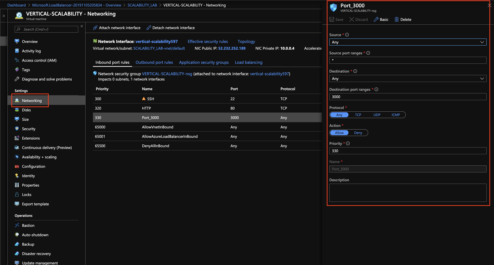
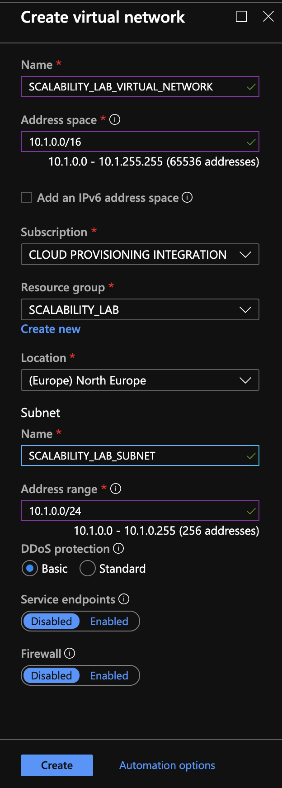
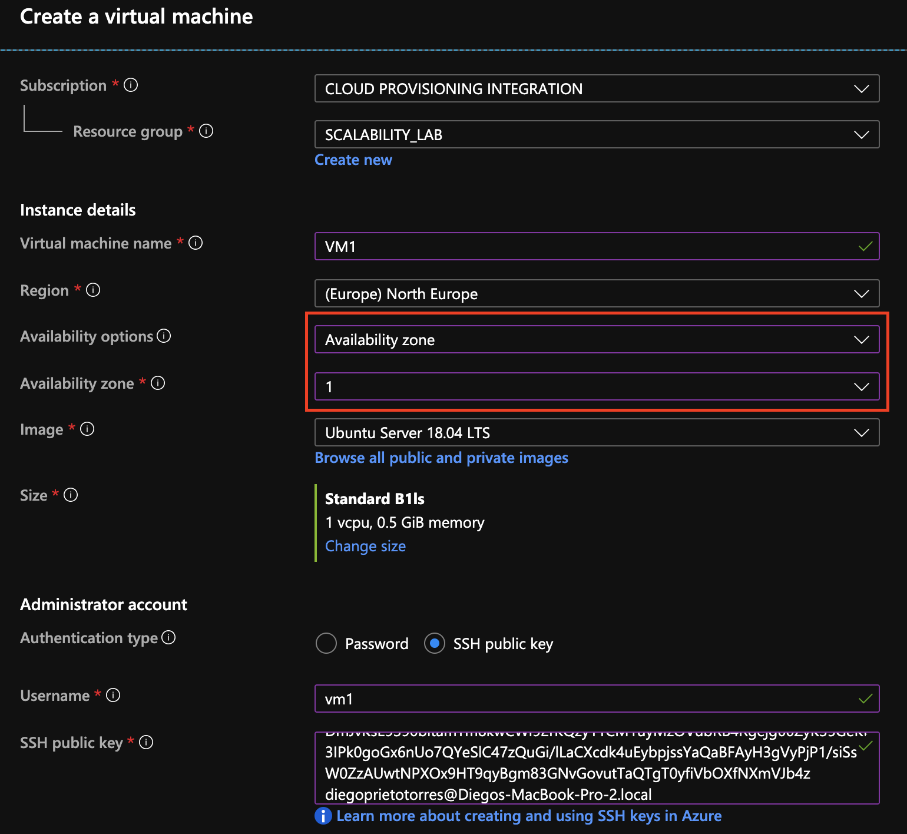
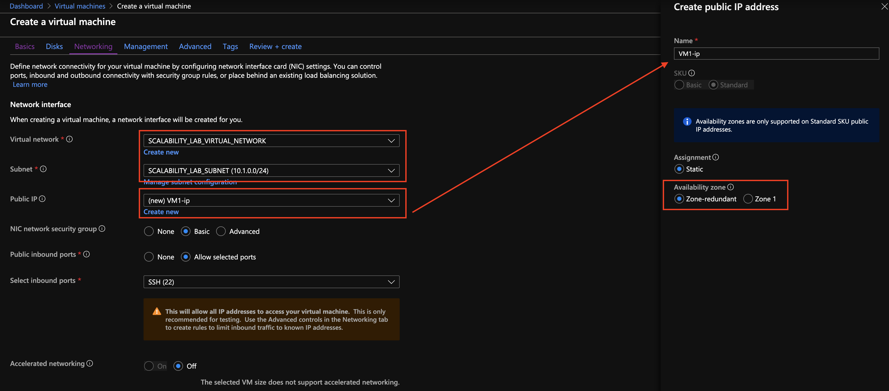
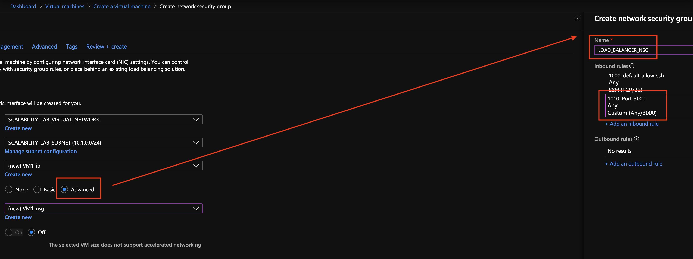
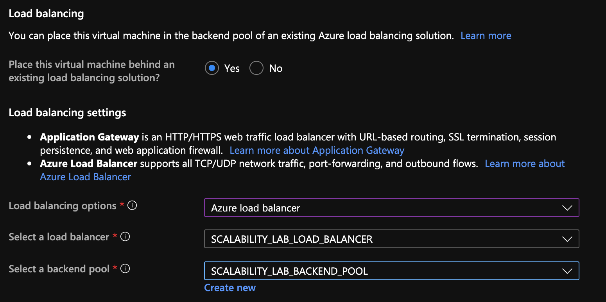

### Escuela Colombiana de Ingeniería
### Arquitecturas de Software - ARSW

## Escalamiento en Azure con Maquinas Virtuales, Sacale Sets y Service Plans

### Dependencias
* Cree una cuenta gratuita dentro de Azure. Para hacerlo puede guiarse de esta [documentación](https://azure.microsoft.com/es-es/free/students/). Al hacerlo usted contará con $100 USD para gastar durante 12 meses.

### Parte 0 - Entendiendo el escenario de calidad

Adjunto a este laboratorio usted podrá encontrar una aplicación totalmente desarrollada que tiene como objetivo calcular el enésimo valor de la secuencia de Fibonnaci.

**Escalabilidad**
Cuando un conjunto de usuarios consulta un enésimo número (superior a 1000000) de la secuencia de Fibonacci de forma concurrente y el sistema se encuentra bajo condiciones normales de operación, todas las peticiones deben ser respondidas y el consumo de CPU del sistema no puede superar el 70%.

### Parte 1 - Escalabilidad vertical

1. Diríjase a el [Portal de Azure](https://portal.azure.com/) y a continuación cree una maquina virtual con las características básicas descritas en la imágen 1 y que corresponden a las siguientes:
    * Resource Group = SCALABILITY_LAB
    * Virtual machine name = VERTICAL-SCALABILITY
    * Image = Ubuntu Server 
    * Size = Standard B1ls
    * Username = scalability_lab
    * SSH publi key = Su llave ssh publica


2. Para conectarse a la VM use el siguiente comando, donde las `x` las debe remplazar por la IP de su propia VM (Revise la sección "Connect" de la virtual machine creada para tener una guía más detallada).

    `ssh scalability_lab@xxx.xxx.xxx.xxx`

3. Instale node, para ello siga la sección *Installing Node.js and npm using NVM* que encontrará en este [enlace](https://linuxize.com/post/how-to-install-node-js-on-ubuntu-18.04/).
4. Para instalar la aplicación adjunta al Laboratorio, suba la carpeta `FibonacciApp` a un repositorio al cual tenga acceso y ejecute estos comandos dentro de la VM:

    `git clone <your_repo>`

    `cd <your_repo>/FibonacciApp`

    `npm install`

5. Para ejecutar la aplicación puede usar el comando `npm FibinacciApp.js`, sin embargo una vez pierda la conexión ssh la aplicación dejará de funcionar. Para evitar ese compartamiento usaremos *forever*. Ejecute los siguientes comando dentro de la VM.

    ` node FibonacciApp.js`

6. Antes de verificar si el endpoint funciona, en Azure vaya a la sección de *Networking* y cree una *Inbound port rule* tal como se muestra en la imágen. Para verificar que la aplicación funciona, use un browser y user el endpoint `http://xxx.xxx.xxx.xxx:3000/fibonacci/6`. La respuesta debe ser `The answer is 8`.



7. La función que calcula en enésimo número de la secuencia de Fibonacci está muy mal construido y consume bastante CPU para obtener la respuesta. Usando la consola del Browser documente los tiempos de respuesta para dicho endpoint usando los siguintes valores:
    * 1000000
    * 1010000
    * 1020000
    * 1030000
    * 1040000
    * 1050000
    * 1060000
    * 1070000
    * 1080000
    * 1090000    

8. Dírijase ahora a Azure y verifique el consumo de CPU para la VM. (Los resultados pueden tardar 5 minutos en aparecer).


9. Ahora usaremos Postman para simular una carga concurrente a nuestro sistema. Siga estos pasos.
    * Instale newman con el comando `npm install newman -g`. Para conocer más de Newman consulte el siguiente [enlace](https://learning.getpostman.com/docs/postman/collection-runs/command-line-integration-with-newman/).
    * Diríjase hasta la ruta `FibonacciApp/postman` en una maquina diferente a la VM.
    * Para el archivo `[ARSW_LOAD-BALANCING_AZURE].postman_environment.json` cambie el valor del parámetro `VM1` para que coincida con la IP de su VM.
    * Ejecute el siguiente comando.

    ```
    newman run ARSW_LOAD-BALANCING_AZURE.postman_collection.json -e [ARSW_LOAD-BALANCING_AZURE].postman_environment.json -n 10 &
    newman run ARSW_LOAD-BALANCING_AZURE.postman_collection.json -e [ARSW_LOAD-BALANCING_AZURE].postman_environment.json -n 10
    ```

10. La cantidad de CPU consumida es bastante grande y un conjunto considerable de peticiones concurrentes pueden hacer fallar nuestro servicio. Para solucionarlo usaremos una estrategia de Escalamiento Vertical. En Azure diríjase a la sección *size* y a continuación seleccione el tamaño `B2ms`.


11. Una vez el cambio se vea reflejado, repita el paso 7, 8 y 9.
12. Evalue el escenario de calidad asociado al requerimiento no funcional de escalabilidad y concluya si usando este modelo de escalabilidad logramos cumplirlo.
13. Vuelva a dejar la VM en el tamaño inicial para evitar cobros adicionales.

**Preguntas y sus respuestas**

1. ¿Cuántos y cuáles recursos crea Azure junto con la VM?

Se crean 6 recursos (sin contar el grupo de recursos): la máquina virtual, el disco del sistema operativo, la interfaz de red (NIC), la dirección IP pública, el Network Security Group (NSG) y la red virtual con su subred.

2. ¿Brevemente describa para qué sirve cada recurso?

- **Máquina virtual:** el cómputo (CPU y RAM) donde corre Ubuntu y la aplicación.
- **Disco del SO:** almacenamiento persistente donde vive el sistema operativo.
- **NIC:** conecta la VM a la red virtual y le asigna IP privada.
- **IP pública:** permite acceder a la VM desde Internet (SSH y el puerto 3000).
- **NSG:** firewall que permite o bloquea tráfico entrante y saliente por puerto, protocolo y origen.
- **Virtual network / subnet:** red privada donde se ubica la VM.

3. ¿Al cerrar la conexión ssh con la VM, por qué se cae la aplicación que ejecutamos con el comando `npm FibonacciApp.js`? ¿Por qué debemos crear un *Inbound port rule* antes de acceder al servicio?

Al ejecutar la app directamente en la terminal, queda como proceso hijo de la sesión SSH. Cuando esta se cierra, el sistema envía la señal de cierre al proceso y la app termina. Con `forever` la app corre desmonetizada de la sesión y se mantiene viva (y se reinicia si falla).

La regla de entrada es necesaria porque el NSG, por defecto, solo permite lo explícitamente autorizado (en este caso SSH, puerto 22). Sin una regla para el puerto 3000, el tráfico hacia la app se descarta antes de llegar a la VM.

4. Adjunte tabla de tiempos e interprete por qué la función tarda tando tiempo.

| n | D2s_v4 (ms) | D4s_v4 (ms) |
|---|---|---|
| 1000000 | 7062 | 6943 |
| 1010000 | 7704 | 7074 |
| 1020000 | 8143 | 7170 |
| 1030000 | 7700 | 7331 |
| 1040000 | 7576 | 7491 |
| 1050000 | 7697 | 7667 |
| 1060000 | 7820 | 7765 |
| 1070000 | 7974 | 7906 |
| 1080000 | 8138 | 8039 |
| 1090000 | 8289 | 8205 |

La función suma enteros de precisión arbitraria en un ciclo. F(1.000.000) tiene unos 209.000 dígitos, y cada suma cuesta proporcional al tamaño del número, que crece en cada iteración; además cada término depende del anterior, así que el cálculo es secuencial. Por eso el tiempo crece más rápido que *n*: de 1.000.000 a 1.090.000 *n* sube 9% y el tiempo sube cerca de 17%. Con más vCPU el tiempo promedio solo bajó ~3%, porque cada petición se ejecuta en un solo hilo de Node.

demostracion en video

5. Adjunte imágen del consumo de CPU de la VM e interprete por qué la función consume esa cantidad de CPU.

El pico fue de 99% en la D2s_v4 (2 vCPU) y de 80% en la D4s_v4 (4 vCPU). El cálculo es puro CPU, sin esperas de E/S. Aunque el porcentaje bajó, el consumo absoluto fue de ~2 núcleos en la D2s_v4 y ~3,2 en la D4s_v4. [COMPLETAR solo si lo verificas con top -H: el uso adicional corresponde a hilos auxiliares de Node, probablemente el recolector de basura.]

demostracion en video

6. Adjunte la imagen del resumen de la ejecución de Postman. Interprete:
    * Tiempos de ejecución de cada petición.
    * Si hubo fallos documentelos y explique.

| | D2s_v4 | D4s_v4 |
|---|---|---|
| Peticiones exitosas | 20 de 20 | 20 de 20 |
| Fallos | 0 | 0 |
| Promedio | 13,6 s / 12,3 s | 14,2 s / 13,3 s |
| Mín / máx | 7,2 s - 20,4 s / 7,1 s - 13,9 s | 7,5 s - 20,9 s / 7,8 s - 15,4 s |

demostracin en video 

7. ¿Cuál es la diferencia entre los tamaños `B2ms` y `B1ls` (no solo busque especificaciones de infraestructura)?

Ambas son de la serie B (*burstable*), que a diferencia de otras series no entrega CPU constante sino un rendimiento base más un sistema de créditos: la VM acumula créditos mientras usa menos CPU que su base y los gasta cuando la supera; al agotarlos, se limita nuevamente a su rendimiento base.

| | B1ls | B2ms |
|---|---|---|
| vCPU / RAM | 1 / 0,5 GiB | 2 / 8 GiB |
| Rendimiento base | 5% | 60% (30% por vCPU) |
| Créditos por hora | 3 | 36 |
| Créditos máximos acumulables | 72 | 864 |

La diferencia no es solo de infraestructura: la B1ls solo garantiza el 5% de un vCPU y sus créditos se agotan en pocos minutos bajo carga sostenida, quedando limitada a ese 5%. La B2ms garantiza una base mucho mayor y acumula muchos más créditos, por lo que tolera ráfagas más largas. Para una carga de CPU continua como el cálculo de Fibonacci, ninguna de las dos es ideal, porque al agotar los créditos ambas se estrangulan.

**VMs usadas en esta práctica:** la serie B no estaba disponible en mi suscripción Azure for Students, por lo que usé `D2s_v4` y `D4s_v4`. Ambas pertenecen a la serie Dsv4 (uso general) y no son burstable: entregan CPU constante, sin créditos.

| | D2s_v4 | D4s_v4 |
|---|---|---|
| vCPU | 2 | 4 |
| RAM | 8 GiB | 16 GiB |
| Discos de datos máx. | 4 | 8 |
| IOPS máximas | 3200 | 6400 |
| Costo aprox. | 78,84 USD/mes | 158,41 USD/mes |

La D4s_v4 duplica los recursos y el costo de la D2s_v4. Como ninguna usa créditos, las diferencias observadas entre ambas en las pruebas se deben solo a la cantidad de vCPU y memoria, y no a un modelo de ráfagas.

8. ¿Aumentar el tamaño de la VM es una buena solución en este escenario?, ¿Qué pasa con la FibonacciApp cuando cambiamos el tamaño de la VM?

No es una buena solución en este escenario: la app usa un solo hilo, por lo que más núcleos no aceleran una petición, y la solución tiene un techo (el tamaño máximo) y sigue siendo un único punto de falla. Al cambiar el tamaño, la VM se reinicia y la app deja de estar disponible; como `forever` no sobrevive al reinicio, hay que volver a lanzarla manualmente.


9. ¿Qué pasa con la infraestructura cuando cambia el tamaño de la VM? ¿Qué efectos negativos implica?

La VM se detiene y se reasigna a hardware con el nuevo tamaño, y luego se reinicia. Efectos negativos: tiempo de inactividad, pérdida de lo que esté en el disco temporal, posible cambio de IP si no es estática, procesos que hay que relanzar y mayor costo por hora.


10. ¿Hubo mejora en el consumo de CPU o en los tiempos de respuesta? Si/No ¿Por qué?

Parcialmente. Los tiempos no mejoraron: el promedio en Newman fue igual o algo peor en la D4s_v4 y en consola solo bajó ~3%, porque la función no aprovecha varios núcleos. El pico de CPU bajó de 99% a 80%, pero eso se debe a que el porcentaje se mide sobre más vCPU; en núcleos absolutos la D4s_v4 usó más. Ninguna de las dos configuraciones cumple el límite del 70% del escenario de calidad.

11. Aumente la cantidad de ejecuciones paralelas del comando de postman a `4`. ¿El comportamiento del sistema es porcentualmente mejor?

El comportamiento no mejora porcentualmente: con un único hilo de Node las peticiones se atienden una a una, así que más ejecuciones simultáneas solo alargan la cola de espera y aumentan los fallos o tiempos. Tener más vCPU no cambia esto.


VIDEO DEMOSTRACION PRIMERA PARTE

https://youtu.be/91ALFq-b29U

### Parte 2 - Escalabilidad horizontal

#### Crear el Balanceador de Carga

Antes de continuar puede eliminar el grupo de recursos anterior para evitar gastos adicionales y realizar la actividad en un grupo de recursos totalmente limpio.

1. El Balanceador de Carga es un recurso fundamental para habilitar la escalabilidad horizontal de nuestro sistema, por eso en este paso cree un balanceador de carga dentro de Azure tal cual como se muestra en la imágen adjunta.


2. A continuación cree un *Backend Pool*, guiese con la siguiente imágen.


3. A continuación cree un *Health Probe*, guiese con la siguiente imágen.


4. A continuación cree un *Load Balancing Rule*, guiese con la siguiente imágen.


5. Cree una *Virtual Network* dentro del grupo de recursos, guiese con la siguiente imágen.



#### Crear las maquinas virtuales (Nodos)

Ahora vamos a crear 3 VMs (VM1, VM2 y VM3) con direcciones IP públicas standar en 3 diferentes zonas de disponibilidad. Después las agregaremos al balanceador de carga.

1. En la configuración básica de la VM guíese por la siguiente imágen. Es importante que se fije en la "Avaiability Zone", donde la VM1 será 1, la VM2 será 2 y la VM3 será 3.



2. En la configuración de networking, verifique que se ha seleccionado la *Virtual Network*  y la *Subnet* creadas anteriormente. Adicionalmente asigne una IP pública y no olvide habilitar la redundancia de zona.



3. Para el Network Security Group seleccione "avanzado" y realice la siguiente configuración. No olvide crear un *Inbound Rule*, en el cual habilite el tráfico por el puerto 3000. Cuando cree la VM2 y la VM3, no necesita volver a crear el *Network Security Group*, sino que puede seleccionar el anteriormente creado.



4. Ahora asignaremos esta VM a nuestro balanceador de carga, para ello siga la configuración de la siguiente imágen.



5. Finalmente debemos instalar la aplicación de Fibonacci en la VM. para ello puede ejecutar el conjunto de los siguientes comandos, cambiando el nombre de la VM por el correcto

```
git clone https://github.com/daprieto1/ARSW_LOAD-BALANCING_AZURE.git

curl -o- https://raw.githubusercontent.com/creationix/nvm/v0.34.0/install.sh | bash
source /home/vm1/.bashrc
nvm install node

cd ARSW_LOAD-BALANCING_AZURE/FibonacciApp
npm install

npm install forever -g
forever start FibonacciApp.js
```

Realice este proceso para las 3 VMs, por ahora lo haremos a mano una por una, sin embargo es importante que usted sepa que existen herramientas para aumatizar este proceso, entre ellas encontramos Azure Resource Manager, OsDisk Images, Terraform con Vagrant y Paker, Puppet, Ansible entre otras.

#### Probar el resultado final de nuestra infraestructura

1. Porsupuesto el endpoint de acceso a nuestro sistema será la IP pública del balanceador de carga, primero verifiquemos que los servicios básicos están funcionando, consuma los siguientes recursos:

```
http://52.155.223.248/
http://52.155.223.248/fibonacci/1
```

2. Realice las pruebas de carga con `newman` que se realizaron en la parte 1 y haga un informe comparativo donde contraste: tiempos de respuesta, cantidad de peticiones respondidas con éxito, costos de las 2 infraestrucruras, es decir, la que desarrollamos con balanceo de carga horizontal y la que se hizo con una maquina virtual escalada.

3. Agregue una 4 maquina virtual y realice las pruebas de newman, pero esta vez no lance 2 peticiones en paralelo, sino que incrementelo a 4. Haga un informe donde presente el comportamiento de la CPU de las 4 VM y explique porque la tasa de éxito de las peticiones aumento con este estilo de escalabilidad.

```
newman run ARSW_LOAD-BALANCING_AZURE.postman_collection.json -e [ARSW_LOAD-BALANCING_AZURE].postman_environment.json -n 10 &
newman run ARSW_LOAD-BALANCING_AZURE.postman_collection.json -e [ARSW_LOAD-BALANCING_AZURE].postman_environment.json -n 10 &
newman run ARSW_LOAD-BALANCING_AZURE.postman_collection.json -e [ARSW_LOAD-BALANCING_AZURE].postman_environment.json -n 10 &
newman run ARSW_LOAD-BALANCING_AZURE.postman_collection.json -e [ARSW_LOAD-BALANCING_AZURE].postman_environment.json -n 10
```

**Preguntas**

* ¿Cuáles son los tipos de balanceadores de carga en Azure y en qué se diferencian?, ¿Qué es SKU, qué tipos hay y en qué se diferencian?, ¿Por qué el balanceador de carga necesita una IP pública?
* ¿Cuál es el propósito del *Backend Pool*?
* ¿Cuál es el propósito del *Health Probe*?
* ¿Cuál es el propósito de la *Load Balancing Rule*? ¿Qué tipos de sesión persistente existen, por qué esto es importante y cómo puede afectar la escalabilidad del sistema?.
* ¿Qué es una *Virtual Network*? ¿Qué es una *Subnet*? ¿Para qué sirven los *address space* y *address range*?
* ¿Qué son las *Availability Zone* y por qué seleccionamos 3 diferentes zonas?. ¿Qué significa que una IP sea *zone-redundant*?
* ¿Cuál es el propósito del *Network Security Group*?
* Informe de newman 1 (Punto 2)
* Presente el Diagrama de Despliegue de la solución.


